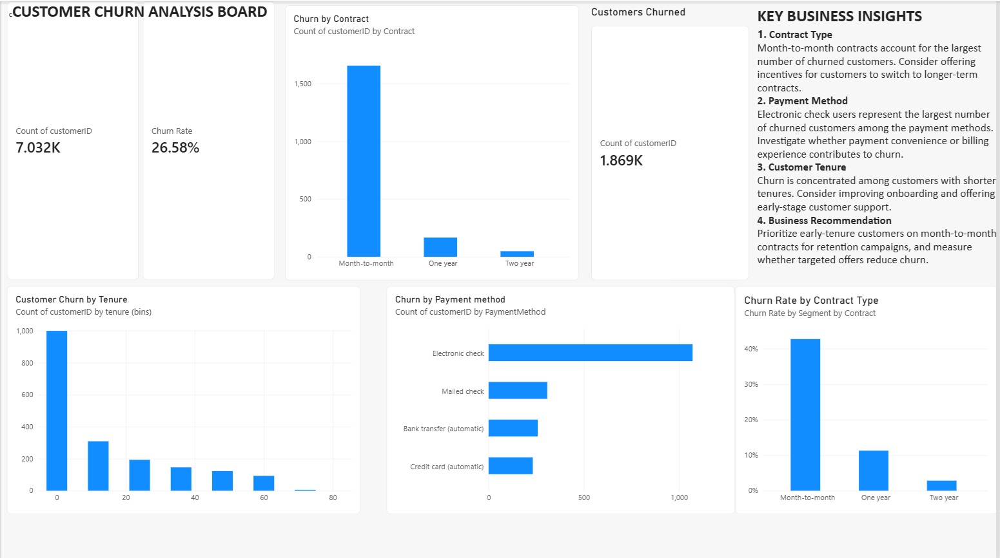

# Customer Churn Analysis

## Project Overview
This project analyzes customer churn for a telecommunications company using Python, MySQL, and Power BI. The goal is to identify customer segments with high churn rates and generate insights to support customer retention.

## Tools and Technologies
- Python
- Pandas
- Matplotlib
- MySQL
- Power BI
- Git and GitHub

## Dataset
The dataset contains customer demographics, services, contract types, payment methods, monthly charges, tenure, and churn status.

- Original dataset: 7,043 records
- Cleaned dataset: 7,032 records
- Missing values in `TotalCharges` were handled during data cleaning.

## Project Structure
```text
customer-churn-analysis/
├── data/
│   ├── raw/
│   └── processed/
├── powerbi/
│   └── Customer_Churn_Analysis.pbix
├── python/
│   ├── churn_analysis.py
│   └── import_to_mysql.py
├── reports/
│   ├── churn_by_contract.png
│   ├── churn_by_payment_method.png
│   ├── churn_by_tenure.png
│   └── monthly_charges_by_churn.png
├── sql/
├── .gitignore
└── README.md
```

## Key Findings
- Overall customer churn rate: approximately 26.58%.
- Month-to-month contracts show higher churn than longer-term contracts.
- Customer tenure is an important factor when examining churn patterns.
- Payment method is another useful dimension for understanding churn.

## How to Run
1. Install Python and the required libraries.
2. Run the analysis script:
   `python python/churn_analysis.py`
3. Review the generated charts in the `reports/` folder.
4. Open `powerbi/Customer_Churn_Analysis.pbix` using Power BI Desktop.
5. Configure your local MySQL connection before running the database import script.

## Business Objective
Identify customer segments with high churn and provide insights that can help a telecommunications business improve customer retention.

## Future Improvements
- Add SQL queries for churn analysis and customer segmentation.
- Create additional retention metrics.
- Develop a machine learning model to predict customer churn.
- Improve the Power BI dashboard with more interactive filters and KPIs.
## Power BI Dashboard

The dashboard provides a visual analysis of customer churn, highlighting churn patterns across contract types, payment methods, customer tenure, and monthly charges.

